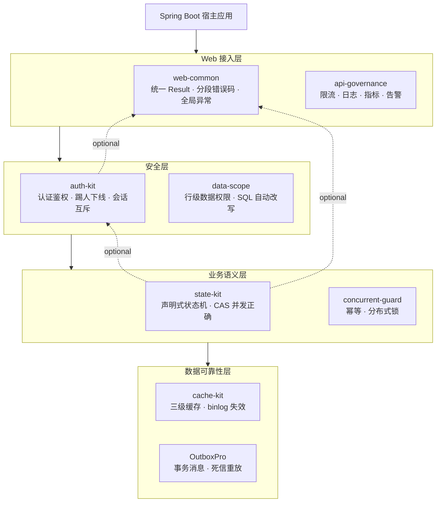

# biglv666 Spring Boot Starter BOM

[](https://github.com/BIGLV666/biglv666-spring-boot-bom/actions/workflows/ci.yml)

biglv666 全家桶的**版本对齐清单（Bill of Materials）**：一个纯 `pom` 仓库，把七个已发布组件的全部 artifact 版本收拢到 `<dependencyManagement>`，使用方一次 import 即完成版本对齐，不再逐个写版本号。

本仓库**不包含 Java 代码，也不修改任何组件的代码**——组件各自独立仓库、独立发版，本仓库只做版本收口与文档整合。

## 全家桶架构

八个组件按职责分四层，全部 `optional`、按需单独引入，不要求全家桶一起上：



典型请求链路：`api-governance` 先限流与治理 → `auth-kit` 判断“这个接口能不能调” → `data-scope` 决定“能看哪几行” → `concurrent-guard` 拦住重复提交 → `state-kit` 用 CAS 保证状态不被并发改坏 → 数据落到 `cache-kit`、事件经 `OutboxPro` 可靠发出。每层都可以单独使用。

## 组件一览

| 组件 | Maven 坐标（`io.github.biglv666`） | BOM 当前版本 | 定位 | 仓库 |
|---|---|---|---|---|
| auth-kit | `auth-kit-spring-boot-starter` | 1.1.0 | 认证鉴权：不透明 token + 有状态会话，踢人下线/同端互斥/滑动续期 | [BIGLV666/auth-kit-spring-boot-starter](https://github.com/BIGLV666/auth-kit-spring-boot-starter) |
| api-governance | `api-governance-spring-boot-starter` | 0.5.0 | API 治理：限流、指标、日志、告警、管理接口 | [BIGLV666/api-governance-spring-boot-starter](https://github.com/BIGLV666/api-governance-spring-boot-starter) |
| concurrent-guard | `guard-spring-boot-starter` | 0.2.0 | 并发防护：注解式幂等（防重复提交）+ 注解式分布式锁 | [BIGLV666/concurrent-guard](https://github.com/BIGLV666/concurrent-guard) |
| web-common | `web-common-spring-boot-starter` | 0.3.0 | Web 通用封装：统一 Result、分段错误码、全局异常处理 | [BIGLV666/web-common-spring-boot-starter](https://github.com/BIGLV666/web-common-spring-boot-starter) |
| state-kit | `state-kit-spring-boot-starter` | 0.2.0 | 声明式状态流转：yml/DSL 声明规则，CAS 保证并发正确 | [BIGLV666/state-kit-spring-boot-starter](https://github.com/BIGLV666/state-kit-spring-boot-starter) |
| OutboxPro | `outboxpro-spring-boot-starter`（多模块，含 parent 共 10 个 artifact） | 1.1.0 | 事务消息：Outbox 模式 + RabbitMQ 可靠消费 + 死信重放 | [BIGLV666/OutboxPro](https://github.com/BIGLV666/OutboxPro) |
| cache-kit | `cache-kit-spring-boot-starter` | 0.3.0 | 三级缓存：Caffeine→Redis→DB read-through，广播 + 延迟双删 + binlog 直连失效 | [BIGLV666/cache-kit-spring-boot-starter](https://github.com/BIGLV666/cache-kit-spring-boot-starter) |
| data-scope | `data-scope-spring-boot-starter` | 1.0.0（未纳入 BOM） | 行级数据权限：`@DataScope` 注解 + SQL 自动改写，与 auth-kit 互补 | [BIGLV666/data-scope-spring-boot-starter](https://github.com/BIGLV666/data-scope-spring-boot-starter) |

> `data-scope` 仅 GitHub 开源、未发布到 Maven Central，因此不在本 BOM 的 `<dependencyManagement>` 中；使用时需 clone 后 `mvn install`。

## 使用方式

在宿主工程的 `pom.xml` 里 `import` 本 BOM，然后按需引入组件（不再写版本号）：

```xml
<dependencyManagement>
    <dependencies>
        <dependency>
            <groupId>io.github.biglv666</groupId>
            <artifactId>biglv666-spring-boot-bom</artifactId>
            <version>1.0.0</version>
            <type>pom</type>
            <scope>import</scope>
        </dependency>
        <!-- 你自己的 Spring Boot BOM / 其他第三方 BOM 照常共存 -->
    </dependencies>
</dependencyManagement>

<dependencies>
    <!-- 例：统一返回体 + 认证鉴权 + 幂等/分布式锁，全都不用写版本 -->
    <dependency>
        <groupId>io.github.biglv666</groupId>
        <artifactId>web-common-spring-boot-starter</artifactId>
    </dependency>
    <dependency>
        <groupId>io.github.biglv666</groupId>
        <artifactId>auth-kit-spring-boot-starter</artifactId>
    </dependency>
    <dependency>
        <groupId>io.github.biglv666</groupId>
        <artifactId>guard-spring-boot-starter</artifactId>
    </dependency>
</dependencies>
```

> **获取方式**：本 BOM 自身尚未发布到 Maven Central。clone 本仓库后执行 `mvn install`，即可用上述坐标在本机/私服引用。除 `data-scope` 外的七个组件均已发布到 Maven Central，可直接解析；如需比 BOM 更新的组件版本，可在自己 pom 中显式指定版本覆盖。

> **Spring Boot 版本由你决定**：本 BOM 刻意不 import `spring-boot-dependencies`。各 starter 的容器依赖都是 `provided`/`optional`，不向使用方传递 Spring Boot 版本；组件当前在 Boot 3.5.x 基线下编译测试。

## 文档导航

1. [`docs/API-REFERENCE.md`](docs/API-REFERENCE.md)：全家桶聚合 API 参考，七个组件的注解、核心接口、SPI、枚举与配置前缀一页通览；
2. 各组件完整文档（镜像自各仓库）：

| 组件 | 文档目录 | 亮点 |
|---|---|---|
| auth-kit | [`docs/auth-kit/`](docs/auth-kit/) | `USAGE.md`、`CONFIGURATION.md`、`INTEGRATION.md` |
| OutboxPro | [`docs/outboxpro/`](docs/outboxpro/) | 快速开始、DLQ、示例应用 |
| api-governance | [`docs/api-governance/`](docs/api-governance/) | `README.md`、`ASYNC_ACTIONS.md` |
| concurrent-guard | [`docs/concurrent-guard/`](docs/concurrent-guard/) | `README.md` |
| web-common | [`docs/web-common/`](docs/web-common/) | 中文 README、`README.en.md` |
| state-kit | [`docs/state-kit/`](docs/state-kit/) | 设计决策 + yml/DSL 双通道 |
| cache-kit | [`docs/cache-kit/`](docs/cache-kit/) | 接入模式、binlog 失效、配置与 FAQ |

各文件来源见 [`docs/INDEX.md`](docs/INDEX.md)。

## 推荐组合

- **Web 基础**：web-common（统一返回体/错误码）→ 所有组件的异常都会映射成统一 `Result`；
- **业务后端全家桶**：web-common + auth-kit + guard + state-kit + api-governance，五件互相有咬合点，见 `docs/API-REFERENCE.md` 末尾「组件间集成点」；
- **异步消息**：任意组合 + OutboxPro（事务内发消息不丢）。

## 许可证

[Apache License 2.0](https://www.apache.org/licenses/LICENSE-2.0.txt)
